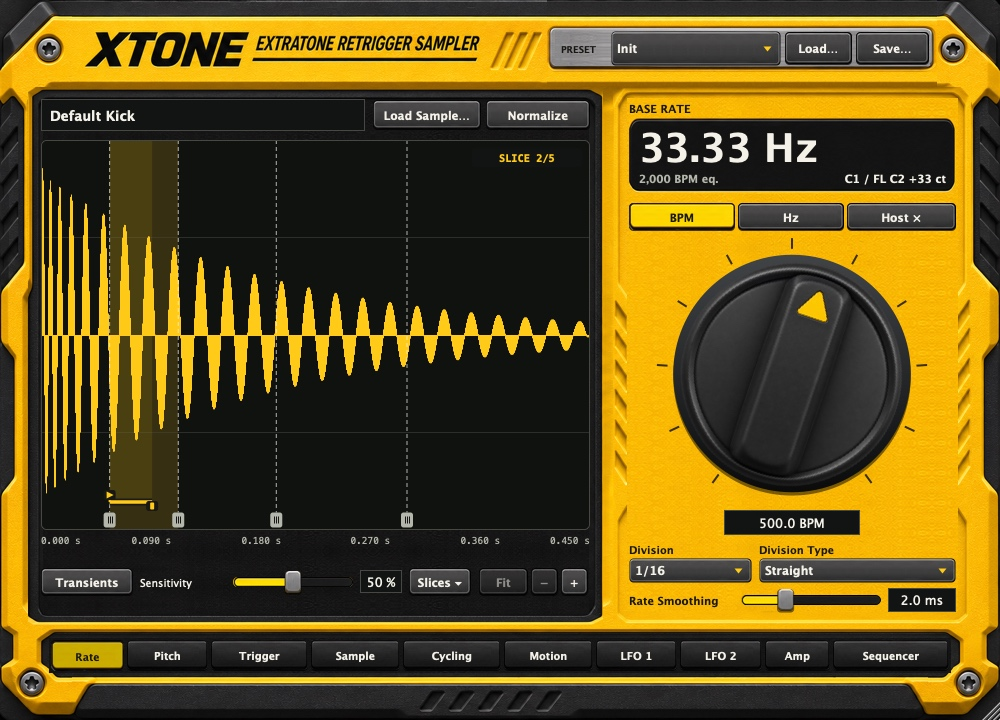
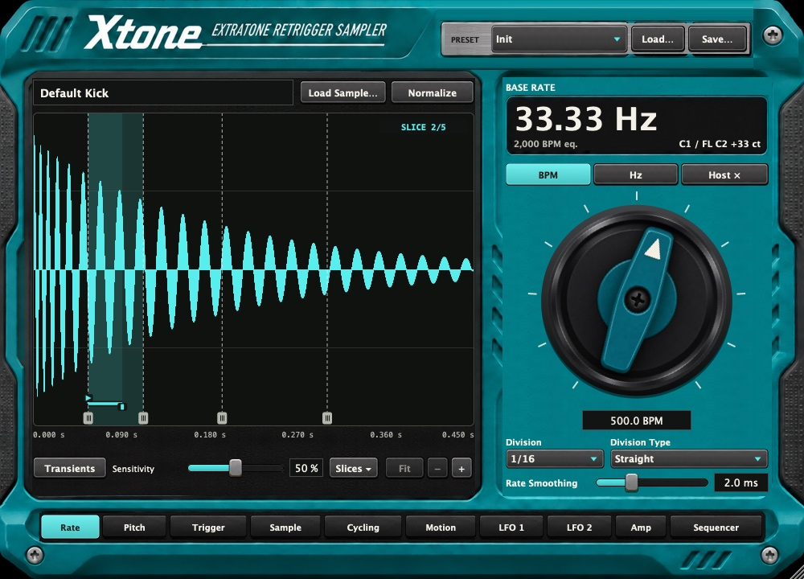
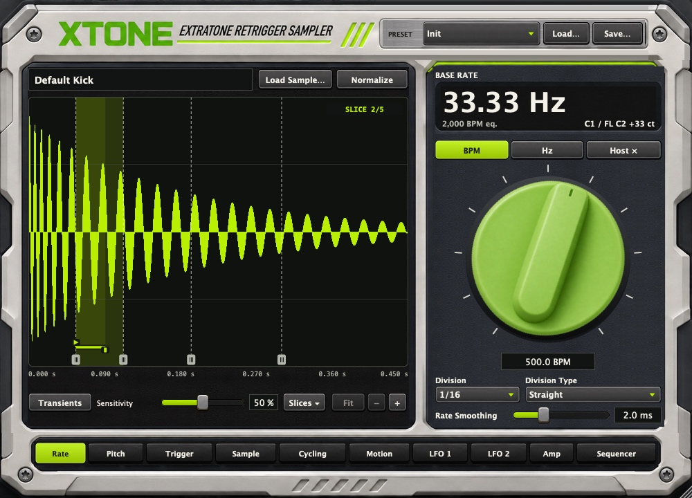
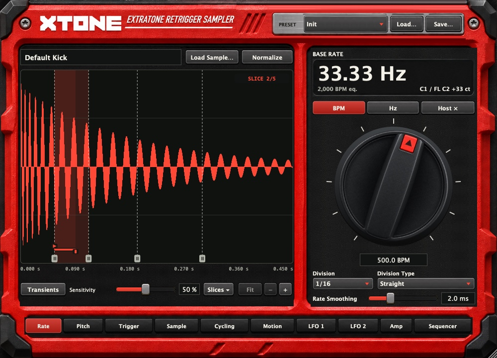
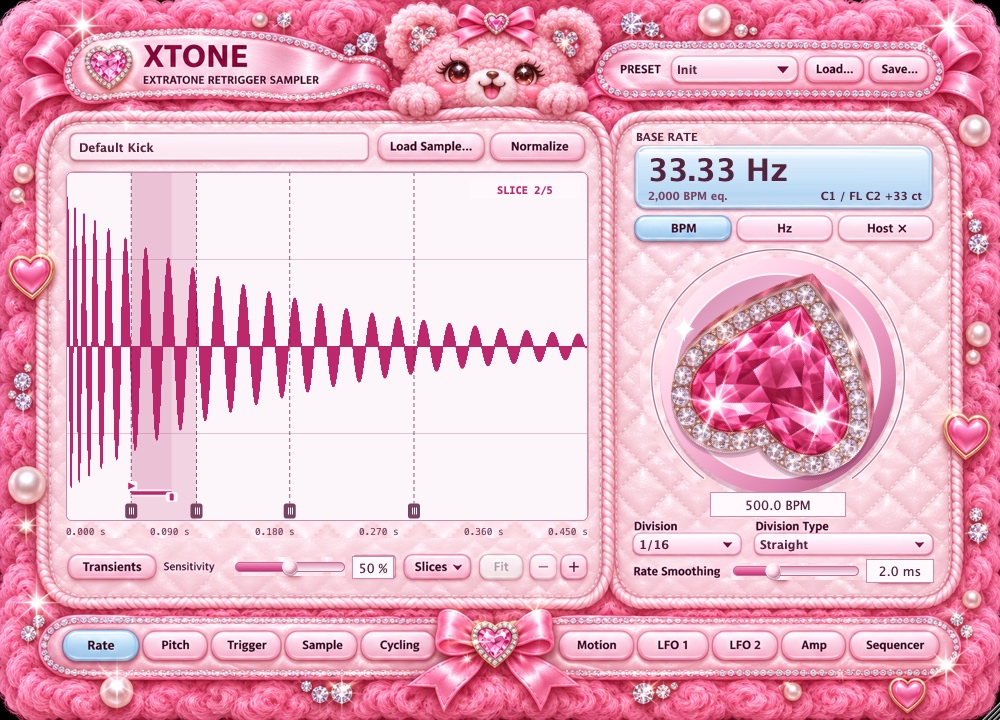
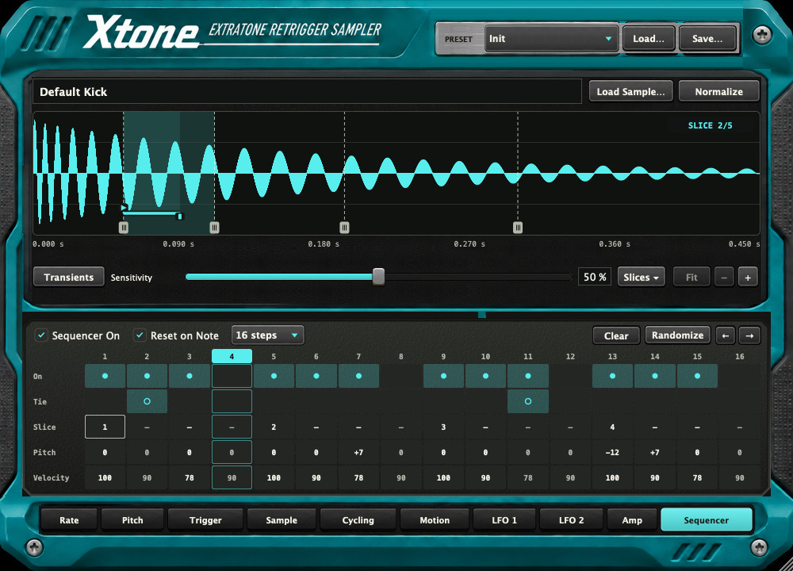

# XTONE v.0.15 – Extratone Retrigger Sampler

XTONE repeatedly retriggers a sample, typically a kick drum, at rates well above 1,000 BPM. At high rates, individual hits merge into a pitched tone. The retrigger rate sets the pitch, and the sample shapes the timbre. XTONE can run on its own clock or follow the host tempo.

See the [technical specification](docs/HANDOFF.md) and [design decisions](docs/DECISIONS.md) for project details.



## Installation on Windows

1. Open the latest successful [Windows build](https://github.com/FruityLemonade/Tone-VST-mac/releases/latest) and download the **XTONE-win64** artifact.
2. Extract the ZIP and copy the `XTONE.vst3` folder to `C:\Program Files\Common Files\VST3\`.
3. In FL Studio, open *Options → Manage plugins* and click *Find installed plugins*. Mark XTONE as a favorite and add it to the Channel Rack.
4. To update, close FL Studio, replace the existing `XTONE.vst3` folder, and restart FL Studio.

To run XTONE outside a DAW, open `XTONE.exe` and select your MIDI input in **Audio/MIDI Settings**.

## Installation on macOS

The universal build includes `XTONE.component` (Audio Unit), `XTONE.vst3`, and `XTONE.app`. It supports Intel and Apple Silicon Macs running macOS 11 or later.

Download the [latest release](https://github.com/FruityLemonade/Tone-VST-mac/releases/latest). Extract the ZIP if you have a prebuilt bundle, or [build XTONE from source](#building-from-source). Create the plug-in folders if needed.

- For **Logic Pro**, copy `XTONE.component` to `~/Library/Audio/Plug-Ins/Components/` and launch Logic Pro. On a software instrument track, select *AU Instruments → XTONE Dev → XTONE → Stereo*. If XTONE is missing, rescan it in the Plug-in Manager.
- For **FL Studio**, copy `XTONE.vst3` to `~/Library/Audio/Plug-Ins/VST3/`. Open *Options → Manage plugins*, click *Find installed plugins*, and add XTONE as an instrument.
- For standalone use, open `XTONE.app` directly.

The macOS bundles are ad hoc signed and have no Apple notarization.

## Quick start

1. Add XTONE as an instrument and play a MIDI note to hear the built-in kick.
2. Open **Rate**, choose **BPM**, and set **Plugin BPM** to 500 and **Division** to 1/16. MIDI note 60 plays about 33.33 Hz in the default **Relative** mode, equivalent to 2,000 quarter-note hits per minute.
3. Load or drop a WAV, AIFF, FLAC, Ogg, or MP3 file onto the editor. Shorten **Length** in **Sample**, then move **Start Scan** to hear how a different part of the slice changes the tone.
4. Add movement in **Motion** or **LFO 1 / 2**, or open **Sequencer** to vary slices, pitch, and level on each tick.

Hover over a control, waveform handle, or step cell for a short explanation.

## Skins

Click the **XTONE** wordmark and choose a skin. **Cotton Candy** uses the Teddy Belly artwork with live controls and a jeweled heart whose tip points to the rate setting. Hammer Drill, Makitone, Festone, and Hiltone use illustrated rotary switches redrawn from the hardware references. The skin belongs to the plugin instance and is saved with the DAW project. Factory and file presets keep the current skin.

| Hammer Drill | Makitone |
| --- | --- |
|  |  |

| Festone | Hiltone |
| --- | --- |
|  |  |



## Controls

| Page | Settings |
| --- | --- |
| **Rate** | **BPM** uses XTONE's own tempo with a straight, dotted, or triplet division. **Hz** sets hits per second directly. **Host ×** multiplies the project tempo before applying the division. **Host Phase Lock** aligns the clock at transport starts and jumps. **Rate Smoothing** softens rate changes. Set it to zero for immediate jumps. The display shows Hz, BPM equivalent, and pitch in scientific and FL Studio notation. |
| **Pitch** | **Pitch** MIDI mode maps notes to retrigger pitch. **Relative** plays the selected rate at **Root Note** and doubles it one octave up. **Absolute** tunes directly from the **A4 Reference**, normally 440 Hz. **Slice** MIDI mode uses notes to select slices relative to **Slice Base Note** and the current slice. Transpose, fine tuning, glide, pitch bend, phase reset, and velocity sensitivity shape MIDI response. **Tune Snap** quantizes the base pitch in **Base** mode and also quantizes modulation in **All** mode. |
| **Trigger** | **Cut** replaces the previous hit. **Overlap** lets hits ring together up to the voice limit. **Declick** smooths hit edges, **Gate** sets when the hit enters release within each retrigger period, and **Jitter** varies hit spacing. **Trigger ADSR** sets the default amplitude envelope for each hit. **Unison** runs up to eight independent clocks with symmetric detune, stereo width, and optional random starting phases. |
| **Sample** | Choose **Slice**, shorten **Length**, and use **Start Scan** to move the playback window. **Reverse**, **Mono**, and **Interpolation** change how the sample is read. **Sample Pitch**, fine tuning, and the per-hit pitch envelope change the sample's playback speed independently of the retrigger clock. |
| **Cycling** | Alternate A and B using **AB**, **AAB**, **ABB**, or **Random**. B has its own slice, window, direction, interpolation, mono setting, level, pitch, and pitch envelope. **Pitch Offset B** adds a musical interval to **Sample Pitch B**. |
| **Motion** | **Ramp Enabled** sweeps the retrigger rate from **Start** to **End** in octaves relative to the base rate. **Time** controls the duration, **Curve** shapes the sweep, and **Repeat** holds the endpoint, loops, or alternates direction. **Restart on Legato** also restarts the ramp on overlapping notes. The endpoints are shown in BPM equivalent before LFOs and final rate snapping. |
| **LFO 1 / 2** | Choose sine, triangle, rising or falling saw, square, sample-and-hold, or smooth random. **Free** uses Hz, **Host Sync** uses a note division at project tempo, and **Rate Ratio** locks one cycle to a fixed number of ticks on the first unison lane. **Start Phase** can be dragged in the preview and **Retrigger on Note** restarts the LFO on a MIDI note-on. Depths are bipolar. **Rate** and **Sample Pitch** update continuously, while **Start Scan** and **Gate** apply at each new hit. |
| **Amp** | Set the note ADSR with the values or graph. Adjust **Drive** before soft or hard clipping, choose 1× to 8× oversampling, and set **Output Gain**. The stereo meter shows the final output level. Click **CLIP** to clear its held 0 dBFS warning. |

MIDI note 60 is C4 in scientific notation and C5 in FL Studio.

## Editing and auditioning slices

- **Normalize** raises the sample peak to full scale.
- Click the waveform to select a slice. Double-click to add a marker, drag it to move it, or right-click to delete it. **Slices** also offers **Slice Evenly** and **Clear All Markers**.
- To give a slice its own amplitude envelope, select it and open **Slices → Edit Slice ADSR**. Turn on **Use custom ADSR**, set the four values, and click **Apply**. Turn the option off and apply to follow the Trigger defaults again. The same envelope applies when MIDI, Cycling, the sequencer, or audition plays that slice.
- **Transients** analyzes the entire sample at the selected **Sensitivity**. Detected transients replace the markers and remain editable by hand. If analysis finds no transients, it keeps the existing markers.
- Alt-click on Windows or Option-click on macOS to audition a slice once through the output. If A and B share a slice, audition B by clicking its violet handle with the modifier held.
- Drag a playback handle to trim its edge while keeping the opposite edge in place. The waveform shows A in the skin accent and B in violet. The white rail indicates playback.
- Scroll to zoom at the pointer. Pan with Shift-scroll, horizontal trackpad scrolling, or the scrollbar. Use **−**, **+**, and **Fit** to adjust the view from the toolbar.

Hit attack and decay restart on each trigger. Release begins when the gate closes or the sequencer reaches a rest. At 100% gate, the release fades toward the playback window's end. The playback window and Cut mode can still end a hit early. **Amp** shapes the combined output across the MIDI note.

## Programming the sequencer

Enable **Sequencer On** and choose a length from 1 to 32 steps. Each lane advances one step per retrigger tick. The highlight follows the first lane. **Reset on Note** returns the pattern to step 1 on the next tick after each note-on. Disable it to continue from the current position across notes.

| Row | What it does |
| --- | --- |
| **On** | Enable a hit or leave a rest. A rest releases playing hits, with **Declick** setting the minimum fade time. |
| **Tie** | With **On** enabled, let the previous hit continue through this tick without a new hit. |
| **Slice** | Choose a numbered slice. Enter **0** (shown as a dash) to follow the current sample or MIDI slice. |
| **Pitch** | Offset sample playback by −24 to +24 semitones. |
| **Velocity** | Set the step's hit level from 0 to 100%. |

Click or drag across **On** and **Tie** to paint steps. Click a numeric cell to type a value or drag vertically to adjust it. With grid focus, use the arrow keys to move, Return to edit, and plus or minus to adjust. **Clear** turns all steps into rests. **Randomize** fills the current loop, and the arrows rotate it. Shortening the loop keeps the steps beyond its end.

The sequencer takes priority over **Cycling**. At audio rates an evenly repeating 4-step pattern can introduce a tone at one quarter of the retrigger rate.



## Saving sounds and projects

DAW projects and **Save** / **Load** in the preset bar store parameters, samples, markers, slice ADSR overrides, and all 32 sequencer steps. Sample files up to 32 MB are embedded. Larger files are saved by path, so keep the original at that location. A missing sample falls back to the built-in kick. The factory preset menu applies parameter settings to the current sample. Start with **Init**, **Speed Grid 500**, or **Melodic A440**.

## Building from source

### Windows

Install CMake 3.25 or later and Visual Studio with C++ desktop development support.

```sh
git clone --recurse-submodules https://github.com/FruityLemonade/Tone-VST-mac.git
cd Tone-VST-mac
cmake -B build -A x64
cmake --build build --config Release --parallel
ctest --test-dir build -C Release --output-on-failure
```

The VST3 and standalone builds are under `build/Xtone_artefacts/Release/`.

### macOS Universal

Install CMake 3.25 or later and the Xcode Command Line Tools (`xcode-select --install`).

```sh
git clone --recurse-submodules https://github.com/FruityLemonade/Tone-VST-mac.git
cd Tone-VST-mac
cmake --preset macos-universal
cmake --build --preset macos-universal --parallel
ctest --preset macos-universal
```

The `AU/`, `VST3/`, and `Standalone/` bundles are under `build-macos-universal/Xtone_artefacts/Release/`.

### DSP core and tests

The DSP core and its tests also build on Linux without JUCE. Run these commands from the checkout with CMake 3.25 or later and a C++20 compiler.

```sh
cmake -B build-dsp -DCMAKE_BUILD_TYPE=Release -DXTONE_BUILD_PLUGIN=OFF
cmake --build build-dsp --parallel
ctest --test-dir build-dsp --output-on-failure
```

## License

JUCE 8 is dual-licensed under the AGPLv3 and a commercial JUCE license. See the [JUCE license terms](https://github.com/juce-framework/JUCE/blob/91ad83ae34a81e0833b1a2b0866f54846370ae53/LICENSE.md).
